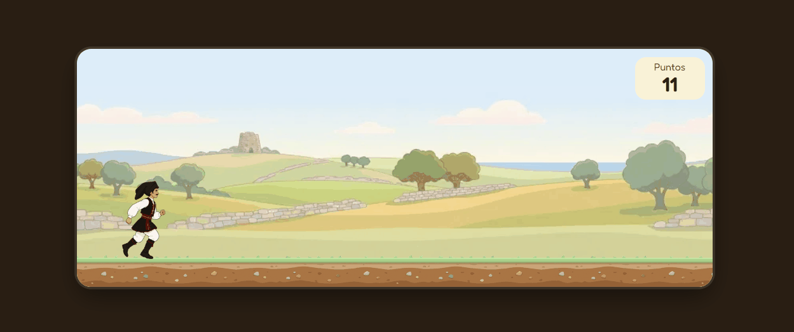

# Su Brincadore

Endless runner ambientato in Sardegna: corri, salta muretti a secco, pecore e cinghiali e fai più punti che puoi.

*English: a Sardinian-themed endless runner built with React and Vite, playable on desktop and mobile.*

**[Play now](https://lioneddu.github.io/su-brincadore/)**

## How to play
| Action | Keyboard | Touch |
|---|---|---|
| Start / Restart | `Enter` | tap |
| Jump | `Space` or `↑` | tap |
 
Obstacles (dry stone wall, sheep, wild boar) appear at random intervals: jump over them all. Your score keeps going up as long as you stay in the race.

## Why React?

I built this to learn React hands-on with something small but fun: a game puts state, effects and closures to the test in a loop that updates 50 times a second. React isn’t the ideal tool for games, which is exactly why it taught me where it helps and where it gets in the way.

## Characteristics
 
- Jumping physics with gravity and initial velocity
- Three obstacles with different sizes and hitboxes
- Running animation with sprite sheets and a layered background with parallax scrolling
- Keyboard and touch controls; gameplay area scaled to fit the phone screen
- Interface in Sardinian with instructions in Italian

## Technical Choices

- **Game loop in React**: A 20-ms `setInterval` updates a single state object using the functional `setState`, so each tick always starts from the latest state.
- **Closures and refs**: Keyboard and touch listeners are registered only once, so they read the state via `useRef` to avoid “stale” values.
- **Collisions**: Rectangles (AABBs) with hitboxes smaller than the sprite. Offsets are calculated based on each sprite’s outline, not the containing rectangle, to avoid “phantom” collisions on empty corners.
- **A single source of truth**: obstacle dimensions, hitboxes, and images are stored in a table (`OBSTACLE_TYPES`); adding an obstacle means adding a row.
- **Rendering with DOM and CSS**, without canvas: sprites animated with `background-position`, background layers that scroll at different speeds.
- **Debug flag** (`DEBUG_HITBOX`) that draws the hitboxes on top of the sprites.

## Contributions

All contributions are welcome: new features, bug fixes, and graphical improvements. For larger changes, please open an issue first to discuss them. Then fork the repository and submit a pull request.

## Credits
 
- Graphics generated using AI tools and edited (ChatGPT). Not perfect, but good enough for a small game.
- Font: [Fredoka](https://fontsource.org/fonts/fredoka)
- License MIT (see LICENSE). The graphics are not covered by this license.